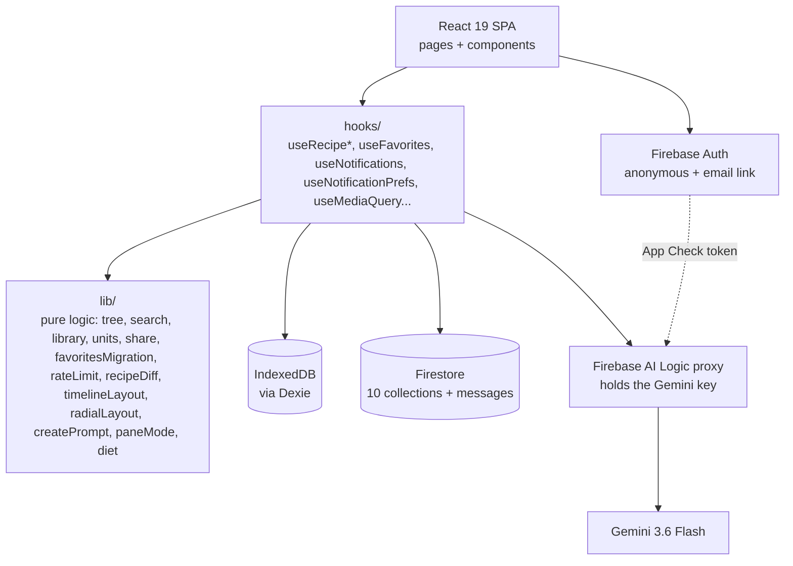

# Architecture

Verified against the code on 2026-07-31.

## Shape

A mobile-first React SPA with no backend of its own. Two stores (IndexedDB and Firestore),
one AI path (a Google-hosted proxy), and one deployed artefact (static files on Firebase
Hosting). There is no server the project operates: the `functions/` directory exists but is
undeployed.

## Layers

**`pages/`** own routing-level state and compose components. **`components/`** are
presentational, grouped by domain (`recipe/`, `chat/`, `auth/`, `profile/`,
`notifications/`, `layout/`, `tree/`) plus a shared `ui/` primitive set (Button, Input, Chip,
Skeleton, EmptyState, ConfirmDialog, Sheet, Spinner, LoadingScreen, PageFallback, Avatar, SegmentedControl, ErrorBoundary, EmojiBlob, UserPill, IconButton). Every icon comes from `ui/icons.tsx`: Lucide
paths (ISC licence) copied into one inline-SVG wrapper at stroke width 2.75, with no icon
dependency. **`hooks/`** (`useBranchEntry` gates every branch entry point on `canGenerate`, opening the 5a sheet instead of navigating)
hold all data access and effects. **`lib/`** is pure, dependency-free logic and is where
the tests live. **`services/`** wrap the outside world: Firebase init, Firestore CRUD,
Gemini, localStorage, analytics. `services/storage.ts` never throws: reads fall back to their
default and writes warn and carry on, so blocked or corrupt storage costs a preference, not the app. This covers `storage.ts` only:
`services/firebase.ts` still reads and writes the `emailForSignIn` key on `localStorage`
directly (in `sendEmailSignInLink` and the sign-in completion), so with storage blocked
those calls can throw. What that does to the email-link flow was not verified end to end.

**Analytics seam and consent gate (RL-052).** `services/analytics.ts` holds the one consent
state (parsed by pure `lib/consent.ts`, stored through `services/storage.ts`). `logEvent` and
`setAnalyticsUserId` call `analyticsProvider.send` and `.identify` (PostHog `capture`,
`identify`, `reset`) only when consent is `granted`. `initialisePostHog()` is the only
`posthog.init`: `main.tsx` calls it before render, and it does nothing without both
`VITE_POSTHOG_KEY` and `VITE_POSTHOG_HOST` or without consent. `AuthContext` re-identifies the
current uid when consent is granted after sign-in. `setAnalyticsConsent(granted)` persists, updates the state and calls
every `onConsentChange` listener: RL-054's single hook for opting PostHog in or out, so no
provider reads consent itself. `hooks/useConsent.ts` (`useSyncExternalStore`) keeps
`ConsentBanner` (mounted in `AppShell` in normal flow above `<main>`, never fixed, so it cannot cover the nav (at lg it takes `lg:ml-[220px]` to clear the rail), update prompt or toasts) and the Settings switch in sync. Both appear only when
`VITE_POSTHOG_KEY` and `VITE_POSTHOG_HOST` are set. Bumping `CONSENT_VERSION` makes every stored choice parse as not
chosen, so the banner asks again. `AppShell` also runs `clearLeftoverGaCookies` once per browser.

The rule that keeps this honest: nothing in `lib/` imports from `services/` or `hooks/`.
That is why `lib/` is testable in node with no mocks beyond `fake-indexeddb`.

**`content/`** holds static text as typed data: `content/legal/` has the draft Terms, Privacy
and Cookie policies (RL-044), imported by `lib/legal.ts`. It imports only from `lib/`.

## Dual storage

For a verified user, Firestore is the source of truth for their own recipes and Dexie is the
cache and offline copy ([decision 1b](decisions.md)). Saves and edits are cloud first: the
recipe is published, and only on success cached in Dexie (RL-082, RL-083), so a failure shows
an error with a retry and leaves nothing local. `hooks/useOwnRecipesSync.ts`, mounted once in
`App.tsx`, keeps Dexie in step on every device (RL-078): one `onSnapshot` on the user's own
recipes (`subscribeOwnRecipes` in `services/firestore.ts`), and each server snapshot applied
with `applyOwnRecipeSync` (`db/recipes.ts`), which runs the pure `planOwnRecipeSync`
(`lib/recipeSync.ts`) in one transaction. Snapshots from the cache or with pending writes are
skipped, because the plan treats a snapshot as the complete list. Edits from two devices are
last write wins. The sync only reads Firestore. `useOwnRecipesSyncStatus` exposes `off`,
`waiting`, `synced` or `error` for the UI. Every Dexie reader (the own profile, Saved,
the detail and edit pages, the tree) then shows the cloud state with no change of its own,
and the last copy when offline. Signing out of a verified account runs `clearOwnRecipes`
(`db/recipes.ts`) after `signOut()` resolves, so the account's own rows leave the device and the
listener reloads them on the next sign-in (RL-085).

Reviewing a suggestion (RL-148, `services/firestore.ts`) never leaves a suggestion marked done
with nothing behind it, and the notification always comes last. `applySuggestion` is one
`runTransaction`, bounded at 5 seconds: it reads the recipe and the suggestion, requires the
suggestion still `pending`, checks the edits against the recipe as read (`StaleSuggestionError`,
nothing written, when any no longer matches), and updates the edited lists, `updatedAt` and
`collaborators` (the suggester added, deduped by uid) together with `status: 'applied'`. After
the commit it caches `toLocalRecipe` of the result (keeping the local `chatHistory`) and
notifies `suggestion_applied`. `keepSuggestionAsBranch` requires the suggestion `pending`,
builds the branch from the cloud parent with `buildBranchFromSuggestion` under
`suggestionBranchId` (a UUID v5 of the suggestion id), and publishes it (create, recipe window)
unless that id already exists, so a retry after a partial failure reuses the first branch rather
than making a second. It reuses an existing document only when it is the owner's own child of
the recipe; the id is guessable, so anything else at that id is refused. A suggestion no longer
`pending` throws `SuggestionClosedError` (`lib/errors.ts`) before any write. Then it caches the branch, writes `status: 'branched'` with `branchId`,
and notifies `suggestion_branched`. Decline writes `status: 'rejected'`, then notifies. A failed
cache or notification never fails the review.

Deleting a recipe is cloud first too (RL-080). An original goes with its whole family through
`deletePublishedRecipeTree` (own documents one by one), and only while every version in the
family is the owner's; otherwise the page blocks it (decision RL-157), and the function itself
deletes nothing when its cloud read finds another cook's document, or when that family read fails (one failure, so Try again). A branch goes alone
(RL-159): `deletePublishedVersion` reads the version's direct children from the cloud (their
stored `depth` is what the rules compare, so the device's is not used), refuses above
`MAX_MOVED_CHILDREN` other cooks' children (`TooManyMovedBranchesError`), and commits one
`writeBatch`: delete the version, set each child's `parentId` to the version's parent and `depth`
one less, and a `moved_{childId}_{deletedId}` notice per other cook's child. A failed commit is retried once,
only when a fresh read finds a different child set; there is no fallback to a plain delete, which
would orphan the children, and the create rule refuses a branch of a missing parent so none can
appear after the read. A timeout is followed by one server read of the version (`isRecipeGoneOnServer`, `getDocFromServer`, since the cache may already show the pending delete; a failure counts as not gone): gone means it landed.
On success the page calls `reparentChildren` on the version's children as Dexie holds them,
then `deleteRecipeTree` (whose subtree is then the version alone), and opens the parent. Deeper descendants keep a stale stored `depth`.

Anonymous, signed-out and local-only users are Dexie only: their saved copies of other
people's recipes never reach the cloud.

Each list reads one store. `hooks/useRecipeLibrary.ts` exports `useLocalLibrary` (a Dexie live
query, behind Saved, the own profile and local-only Explore) and `useCloudLibrary` (the
cursor-paged `getPublishedRecipesPage` feed, behind Explore at `/`, read on first render). The
pure list logic, roots only, dedup by id, newest first, variation counts across both stores, and
the search, favourites and following filters, is `lib/library.ts`. Explore uses following and tags (RL-127 dropped its favourites chip); `filterFeed` keeps a `favoriteIds` option no page uses. Until RL-098 `/` was a
Library with My Recipes and Explore tabs; own recipes now live on the You tab and other people's
kept copies on Saved. Explore also fires one `getRecentPublishedRecipes` week query per session through `hooks/useBranchingThisWeek.ts` (RL-126). One source per list replaced a merged feed whose union of a live query and
a paged window had no stable cursor.

Favourites flow both ways for a verified account. Writes go Dexie first, then
`favorites/{uid}_{recipeId}`. Reads come only from Dexie, which is filled from the cloud once
per session per uid (RL-043): `useHydrateFavorites` in `hooks/useFavorites.ts` calls
`getCloudFavorites` and hands the rows to `addMissingFavorites` (`db/favorites.ts`), which
adds what is missing in one transaction using the pure `selectFavoritesToHydrate`
(`lib/favoritesMigration.ts`). It only adds: nothing local is deleted or overwritten, and a
favourite removed on this device this session is skipped. There is no live listener and no
deletion sync.

The Saved page lists favourites too (RL-121, `hooks/useSavedFavorites.ts`, pure merge `buildSavedList` in
`lib/library.ts`). A favourite whose recipe is not on the device is read from the cloud with
`getPublishedRecipe`, once per session, kept in a module-level map and never cached in Dexie:
a Dexie row of someone else's recipe would be a saved copy, and a favourite is not a copy. The
path is read only; a deleted recipe's favourite is counted, not removed.

What can still disagree: **other users' recipes and saved copies.** A recipe published by
someone else lives only in the cloud unless it was saved to this device, so local-only
features (the version tree, local search) cannot see all of it, and a saved copy is not
refreshed when its owner edits it. Offline, a verified user's own recipes are the last copy
the listener applied.

## The AI path

`services/gemini.ts` calls Gemini through **Firebase AI Logic** (`firebase/ai`), a
Google-hosted proxy. This is the single most important architectural fact:

- The Gemini API key **never reaches the browser**. Firebase provisions and holds it
  server-side. There is deliberately no `VITE_GEMINI_*` env var; `VITE_*` values are
  inlined into the bundle at build time, so a key there would be published.
- **App Check is enforced on this path.** Without a valid attestation token the proxy
  rejects the request, which is why `VITE_RECAPTCHA_SITE_KEY` is required for generation
  and why localhost needs a registered debug token.
- Prompts are still constructed client-side (`lib/prompts.ts`). This is a known and
  accepted limit: a determined user can send arbitrary prompts through your quota. The
  accepted mitigation is App Check plus a `responseSchema` on the model config, which is
  now in place — it does not stop a misused request, it narrows what one can *return* to
  "a valid recipe". The undeployed `functions/generateRecipe` is the escalation path if
  abuse ever appears — it owns the prompts server-side and rate-limits per account, but it
  needs the Blaze plan and would end the free Gemini tier. Photos (below) use the client path
  only: the callable accepts text messages, so moving to it would need a new input path for
  images. Its prompts are a separate hand-written copy in `functions/src/prompts.ts`, not
  `lib/prompts.ts`: it has its own JSON schema text and none of the photo paragraph, and its
  header comment (that the browser no longer uses `lib/prompts.ts`) is out of date.
- **Photos can ride along as generation input (RL-118).** `ChatSession.sendMessage(text,
  images)` sends the text and up to three photos as `inlineData` parts in one
  `chat.sendMessage` call, so one send is still one AI Logic request. Photos are validated by
  `lib/imageAttachments.ts` (JPEG, PNG or WebP, at most 20 MB and 60 megapixels in, 3 per
  message, 6 per chat, counting only turns that generated)
  and downscaled on the client by `services/imageDownscale.ts` (long side 1024px, JPEG on
  white, at most 600 KB). They are held in memory for the chat only and **never stored**:
  not in `chatHistory`, `prompt`, Dexie, Firestore, analytics or telemetry ([decision
  3](decisions.md#3-photos-no-text-first-permanently-recipe-photos-generation-input-photos-see-the-dated-note-below)). A photos-only send uses the text
  `IMAGE_ONLY_PROMPT` so the saved `prompt` stays meaningful. With no photos the request is
  the plain string, as before. A generation error is passed through `redactInlineData` before
  it is logged, reported or classified, in case the SDK echoes the photo data back. The
  prompt tells the model to treat text in a photo as content, never as instructions.

**One schema, three consumers.** `schemas/recipe.responseSchema.ts` builds the recipe shape
with the SDK's `Schema` builders. `gemini.ts` passes it as `responseSchema`, and
`lib/prompts.ts` serialises the *same object* into the system prompt rather than keeping a
hand-written second copy — that copy existed until 2026-07-31 and nothing kept it in step.
Zod (`schemas/recipe.schema.ts`) is a deliberate fourth description, hand-written because
`zod-to-json-schema` is incompatible with Zod v4; a test asserts the two agree on their key
set so they cannot drift silently. The same Zod schema also gates self-contained share links.

Untrusted input is accepted at two boundaries, both gated by Zod. Model output goes through
`parseRecipeJson`, which strips code fences and trailing commas, then validates. Self-contained
share links go through `decodeRecipeFromHash`, which strips unknown keys and returns null on
any failure, shown as the Invalid Link state. Keep the Zod pass: a model config is a request hint,
not a guarantee. The fence-and-comma repair should now be dead code and is kept only because
it is two regexes on a string already in memory.

## Auth and ownership

`contexts/RecipePaneContext.ts` holds the wide-screen pane's recipe id (RL-116; see Routing). `AuthProvider` (`contexts/AuthContext.tsx`) wraps the app and exposes `useAuth()`. It holds
`AppUser`, a plain object extracted from the Firebase `User` so no Firebase class instance
travels through React state. It also holds the Terms prompt state (RL-047) in a separate
`TermsContext`. `AuthProvider` sits outside the router, so `TermsGate`
(`components/auth/TermsUpdateDialog.tsx`), mounted inside `BrowserRouter` in `App.tsx`, shows
the blocking dialog on every route, including those outside `AppShell`, except the three
policy pages. `EmailLinkStatus` (the 15b link outcome sheets) is mounted once beside it, for
the same reason: since RL-135 a magic link returns to the path it was sent from
(`window.location.origin` plus `linkReturnPath` from `lib/pendingAction.ts` in both send
functions in `services/firebase.ts`), which can be any route. The query is never kept; the
hash is kept only on `/shared`, where a self-contained recipe lives in it, and
`clearLinkFromUrl` keeps it there too. Completion itself is unchanged (it still runs
in `AuthContext` on mount, in the order decisions.md records).

The return-to-page link carries a stored intent. `AuthModal` and `SignUpDialog` (through
`EmailLinkingForm`) take an optional `pending` (`PendingIntent` from `lib/pendingAction.ts`:
save, branch or suggest on a recipe id, or follow on a uid) and write it, stamped with the
time, through `setPendingAction` in `services/storage.ts` just before the send, as the email
and the Terms tick are written, because the link can be opened before the send settles. A
send without one clears the key; a failed send clears only an intent it wrote; a successful
guest sign-in in `AuthModal` clears it; and a failed link (expired, email-taken or failed, in
`AuthContext`'s completion catch, not needs-email, whose retry can still succeed) clears it. `getPendingAction` parses it with `parsePendingAction`, which drops wrong shapes and
anything older than an hour (`PENDING_ACTION_TTL_MS`). It is per device, so a link opened elsewhere runs nothing.

RL-136 runs it. When `runEmailLinkCompletion` succeeds without a typed address it awaits
`checkTermsOnce` (cached per uid) and then `claimPendingAction(uid)` stamps the stored intent
with `by`, the uid the link signed in, before `linkState` becomes done. A completion with a
typed address (the cross-device retry) clears it instead, and so does `signOut` or the
auth listener going from a user to none (a sign-out in another tab), but not a load that
starts signed out, which is how the link's own tab begins.
`usePendingAction(match, run)` (`hooks/usePendingAction.ts`), used by `RecipeDetailPage`,
`SharedRecipePage` and `PublicProfile`, runs it once per mount when the user is verified,
auth is not loading, `TermsContext.pending` is false, `by` equals the user's uid and `match`
accepts it; it clears the key before calling `run`. Each page's `match` also waits for what
its `run` reads: the recipe or profile, and the favourite or follow lookup (`ready` on
`useFavorite`, `useCloudFavorite` and `useFollow`), so Save and Follow only ever turn on.
`useFavorite.ready` also waits for the session's first cloud hydrate for that uid to settle
and re-reads Dexie after it, so a cloud-only favourite is not re-added; `useFollow.ready`
stays false after a failed lookup. A branch intent on
the recipe page matches any recipe in the loaded family, since the tree can name another
version.

Ownership is a snapshot, not a join: every recipe carries `createdBy: { uid, displayName }`
stamped at creation. `canManageRecipe` (`lib/ownership.ts`) is the single decision point,
and it treats the user as owner when `createdBy.uid === 'local'` (recipes that predate auth)
or when Firebase is not configured at all. The same rule is enforced independently in
`firestore.rules`; the client check is UI, the rules are the boundary.

## Degradation

Firebase is optional by design. `services/firebase.ts` checks `VITE_FIREBASE_API_KEY`,
`VITE_FIREBASE_AUTH_DOMAIN`, and `VITE_FIREBASE_PROJECT_ID` before initialising anything,
and exports `isFirebaseConfigured`. Every auth and Firestore function is a safe no-op when
unconfigured. Local-only mode is honestly a viewer and importer: it can browse, import,
export, favourite locally-hidden, and share via URL hash, but it **cannot generate
recipes**, because generation is the AI Logic path.

## Named seams

Places designed to be replaced, worth knowing before you change them:

- **`services/gemini.ts`** — the only Gemini caller. Swapping AI Logic for the Cloud
  Function proxy is a change to this file's transport, not to its callers.
- **`lib/errors.ts`** (`describeGenerationError`) — the one place raw provider errors become
  user-facing copy. It also holds `StaleSuggestionError` (RL-148) and `RateLimitedError` and `rateLimitMessage` (RL-048, RL-049),
  which turn a write-limit hit into the suggestion, reply or daily-publish message (a limited
  notification is skipped in `services/firestore.ts` and never reaches a message). New failure modes get mapped here, not at the call site.
- **`components/ui/ErrorBoundary.tsx`**: wraps the routes and the shell outlet; render errors
  show an error-tone EmptyState (`CloudOff` icon, secondary "Back to library" button), report via `reportError`, and clear on route change.
- **`console.error` call sites in hooks and services** — the intended hook points for the
  first-party error beacon (roadmap 1.2).
- **`lib/share.ts`** (`pickShareUrl`) — the cloud-vs-hash decision, isolated so the
  fallback shape can change without touching the share UI. The decode path validates with Zod
  and returns null on failure.
- **`lib/library.ts`** (`buildFeed`, `filterFeed`, `splitLibrary`, `tileRowTitle`, `branchingThisWeek`, `WEEK_MS`): the list logic behind Explore, Saved and the own profile, so
  a browse dimension such as tag chips (RL-009) changes one module.
- **`lib/recipeDiff.ts`** (`diffRecipes`, `summariseChanges`): what a branch changed from its parent,
  computed client-side from ingredients and steps, for the change tags and "What changed" screens
  (no stored data).
- **`lib/suggestion.ts`** (`composeSuggestionMessage`, `parseAmountText`, `describeEdits`, `applySuggestionEdits`, `hasApplicableEdits`, `noteOf`, `buildBranchFromSuggestion`, `MAX_WHY`, `MAX_NOTE`, `MAX_MESSAGE`): the structured suggestion model (RL-145). A suggestion may carry `edits[]` and `branchId`; `composeSuggestionMessage` still writes the free-text `message` from them, and the helpers describe, apply and branch from the edits. Suggest mode writes them (RL-147); Apply and Keep as branch read them (RL-148).
- **`components/recipe/SuggestMode.tsx`** (RL-107): the recipe page and the shared page as the suggest form; composes with
  `lib/suggestion.ts` and sends `{ message, edits }` through the page's existing submit (ingredient and step edits plus a general note).
- **`lib/createPrompt.ts`** (`CREATE_OPTIONS`, `cycleWord`, `buildCreatePrompt`, RL-125): the Create tab's three
  cycling words and the prompt they build for the chat, so the options or the sentence change in one module.
- **`lib/diet.ts`** (`dietLabel`, RL-130): the diet pill's label from `recipe.tags`, so there is no diet field
  and a new diet is one line in one module.
- **`lib/search.ts`** — scoring extracted from both dedup paths, so a real search index
  would replace one module.

## The unsaved-work guard

Two pages hold work that exists only in component state: `RecipeChatPage` (a generated
recipe before it is saved) and `RecipeEditPage` (a dirty form). Both use
`hooks/useUnsavedGuard.ts`, which parks a sentinel history entry while there is work to
protect; the first Back pops the sentinel instead of leaving, the handler re-pushes it so the
user stays put, and the host opens its discard dialog. `beforeunload` covers reload and tab
close.

It is a hook rather than two copies because the mechanism is subtle and the reasoning behind
it was expensive — `useBlocker` does not work here, see [decisions.md](decisions.md). The
callback is held in a ref so the effect's deps stay `[active]`; a changing callback identity
would push a fresh sentinel every render and stack entries the user has to Back through one
by one.

## Routing

Plain `BrowserRouter` with `<Routes>`, not `createBrowserRouter`. That migration was
attempted and reverted: `useBlocker` did not block POP navigation in react-router 7.13.0.
The shipped unsaved-work guard is a sentinel history entry instead. See
[decisions.md](decisions.md) before re-litigating.

Every page except `ExplorePage` is `React.lazy` in `App.tsx`, so each is its own chunk and the
landing page keeps first paint. A `Suspense` with `PageFallback` (the shared `Spinner`) sits inside
the `RouteErrorBoundary` in both `App.tsx` and `AppShell.tsx`, so the shell stays mounted while a
shell route loads and a failed chunk load lands in the error fallback. Firebase is a manual
`firebase` chunk in `vite.config.ts`; `services/` imports it statically, so it still loads at
start and is split only for caching.

`AppShell` wraps `/` (`ExplorePage`, eager, RL-098), `/search` (`SearchPage`, RL-124), `/saved`
(`SavedPage`), `/new` (`CreatePage`, RL-125) and `/activity` (`ActivityPage`), all four lazy, and `/profile`. Its `BottomNav`
(RL-097) is five `Link`s: Explore, Saved, Create (a link to `/new`, the sentence builder, which hands its prompt to `/create`),
Activity and You. Each sets `aria-current="page"` from `matchPath` on the current path, and
Explore is also current on `/search` (a `NavLink` could not do that). The Activity badge reads `useNotifications()`, which
reports 0 when signed out or local-only, and also needs a verified email, as ActivityPage does. Since RL-155 the list, the unread count (so the badge) and Mark all read are post-filter: `useNotifications` applies `visibleFor` with the owner's `hooks/useNotificationPrefs.ts` choices, and stays loading with a badge of 0 until those arrive, so a switched-off type never flashes. From `lg` (1024px) the same single `nav` is a fixed 220px left rail (CSS only, RL-115): `AppShell` main takes `lg:ml-[220px] lg:pb-0`, `UpdatePrompt` moves to `lg:left-[220px] lg:bottom-4` on shell routes only, and `CreatePage` drops its nav-height sticky offset (`lg:bottom-0`, `lg:min-h-dvh`). The bar is fixed, 78px plus the safe area, below lg; beyond
8px; `AppShell`'s `<main>` padding and `UpdatePrompt`'s offset use the same sum. `/settings` sits
outside the shell, reached from the You tab's gear, with its own Back button.
`/recipe/:id/suggestion/:suggestionId` (`SuggestionThreadPage`, RL-106) is lazy and outside the
shell too, with its own Back button; it is the reply thread on one suggestion.

Related families (RL-163). `getRelatedFamilies` in `services/firestore.ts` returns the matched original for a recipe with `relatedFamilyId`, or up to 3 recipes pointing at an original (equality query, `limit(20)`, sorted newest first on the client so no composite index). Each row's version count is a `getCountFromServer` on `rootId`; if that fails the row has no count. `hooks/useRelatedFamilies.ts` runs it once per recipe view, no listener, 5 s bound, empty offline, errors swallowed and reported as `related-families`. `RelatedFamilies` (in `components/recipe/RelatedFamilyCard.tsx`) wires the hook and the carried list origin into the presentational `RelatedFamilyCard`, and `RecipeDetailPage` passes it to `RecipeContent` through the `afterMeta` slot, between the metadata pills and the ingredients.

Wide-screen pane mode (RL-116). `AppRoutes` (in `App.tsx`) asks `lib/paneMode.ts` (with `wide` always true) whether a recipe belongs to a list: only `/recipe/:id`, and only when navigation state carries `listOrigin` `/` or `/saved`. That holds at every width, so the recipe is the same element on both sides of lg; `AppShell` reads `useMediaQuery(WIDE_QUERY)` (Tailwind's `lg`, 1024px) and only changes layout. Explore rows, the Explore tiles and Saved rows set that state with `listOriginState`. In pane mode `<Routes>` is given a location whose pathname is the list's, so the shell and the list page render exactly as on `/` or `/saved` and are never remounted by selecting, swapping or Back; `RecipePaneContext` carries the recipe id to `AppShell`, which renders `RecipeDetailPage id={...}` (lazy, with its own `Suspense` and an error boundary reset on the recipe id) in a sticky, own-scroll `@container` pane beside a 420px list column (the two named regions "Recipe list" and "Recipe", with a polite "Showing <title>" status), and to the list pages, which demote their `h1` to `h2` and mark the open row `aria-current`. The list scrolls with the window, which is what keeps its place across Back. A direct visit or shared link has no state, so it shows the recipe alone. Links from one recipe to another inside the page (the branch carousel's Open and The original, the lineage crumbs) pass the current origin on with `carriedListOrigin` (2026-10-20), so the hop stays in the shell at every width; a recipe reached from the version tree, a profile or Activity still has no origin and shows alone. A reload keeps the two panes, because the browser keeps `history.state`. In the pane `RecipeDetailPage` pads itself once (16px, 36px 48px from a 36rem pane), renders a `div` instead of its own `main`, sizes its title and emoji on the pane's width, and wraps its footer row. `UpdatePrompt` uses the same helper so it sits beside the rail in pane mode. Below lg `AppShell` renders the recipe alone, full width and window-scrolled, with no `ConsentBanner`, nav or nav padding and no regions or status, so it looks and behaves as its own route did; the page keeps a `div` (the shell's `main` is the landmark) and takes `beside={false}` for its narrow styling. Ordinary narrow navigation unmounts the list behind the recipe, so Back gives a fresh list as before. A resize across 1024px (2026-10-20) remounts nothing: the list, the recipe page and its open sheets, dialogs and drafts keep their state. When the window narrows beside a recipe, the list stays mounted with the `hidden` attribute until it shows again, so Back finds it as it was. `AppShell` moves scroll offsets across the switch: the pane's scroll becomes the window's and back, and the list's window offset is restored on widening or on Back. The status region mounts only beside the list, and mounts empty (the title is cleared on narrowing and only set while wide, read from `matchMedia` at call time), so a resize is not announced and below lg the title never re-renders the shell. Focus inside the recipe survives; focus on a list row or the nav is lost when narrowing hides them. The URL and history are untouched. Pages inside the pane see the list's pathname from `useLocation`, but the real key and state.

The three legal routes (`/terms`, `/privacy`, `/cookies`) are lazy `LegalPage` routes outside
`AppShell` (`src/App.tsx`); their content comes from `src/content/legal/` via `lib/legal.ts`.

## Build and deploy

`npm run build` is `tsc -b && vite build` — the type-check is part of the build, so a type
error fails it. Output lands in `dist/`, which Firebase Hosting serves with a catch-all
rewrite to `index.html` (required for client-side routing). Tailwind v4 runs through the
`@tailwindcss/vite` plugin with no separate config step. The theme is Organic: tokens live in the
`@theme` block of `src/index.css`, with values from `docs/design/organic/tokens.css`, and the fonts
(Caprasimo, Figtree) are self-hosted woff2 files in `public/fonts/`. Dark Organic (20a) is a `.dark` block in the same file that
overrides those variables; `useTheme` sets the class on `<html>`, and an inline script in `index.html` sets it before first paint. `vite-plugin-pwa` (dev dependency) emits
`sw.js` and the manifest into `dist/`; `components/layout/UpdatePrompt.tsx` (mounted in `App.tsx`, outside the routes) registers
the worker and shows the update bar. See [operations.md](operations.md) for the cache-header rule. Two workflows: `ci.yml` runs the
gates, and `preview.yml` deploys `dist/` to the `qa` Hosting preview channel (not live).
