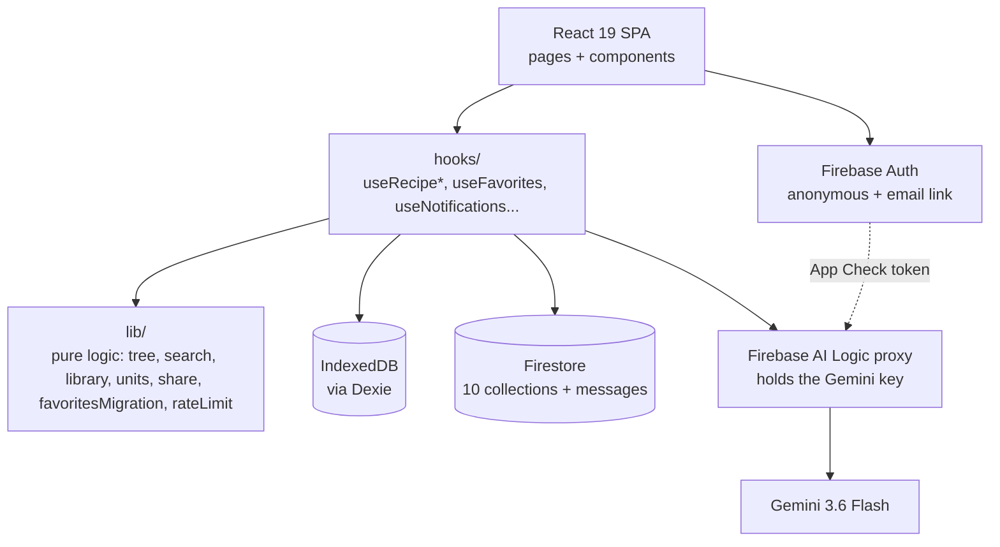

# Architecture

Verified against the code on 2026-07-31.

## Shape

A mobile-first React SPA with no backend of its own. Two stores (IndexedDB and Firestore),
one AI path (a Google-hosted proxy), and one deployed artefact (static files on Firebase
Hosting). There is no server the project operates: the `functions/` directory exists but is
undeployed.

## Layers

**`pages/`** own routing-level state and compose components. **`components/`** are
presentational, grouped by domain (`recipe/`, `chat/`, `auth/`, `profile/`,
`notifications/`, `layout/`) plus a shared `ui/` primitive set (Button, Input, Chip,
Skeleton, EmptyState, ConfirmDialog, FAB, Spinner, PageFallback, Avatar, SegmentedControl, ErrorBoundary). **`hooks/`**
hold all data access and effects. **`lib/`** is pure, dependency-free logic and is where
the tests live. **`services/`** wrap the outside world: Firebase init, Firestore CRUD,
Gemini, localStorage, analytics. `services/storage.ts` never throws: reads fall back to their
default and writes warn and carry on, so blocked or corrupt storage costs a preference, not the app. This covers `storage.ts` only:
`services/firebase.ts` still reads and writes the `emailForSignIn` key on `localStorage`
directly (in `sendEmailSignInLink` and the sign-in completion), so with storage blocked
those calls can throw. What that does to the email-link flow was not verified end to end.

**Analytics seam and consent gate (RL-052).** `services/analytics.ts` holds the one consent
state (parsed by pure `lib/consent.ts`, stored through `services/storage.ts`). `logEvent` and
`setAnalyticsUserId` call `analyticsProvider.send` and `.identify` (PostHog `capture`,
`identify`, `reset`) only when consent is `granted`. `initialisePostHog()` is the only
`posthog.init`: `main.tsx` calls it before render, and it does nothing without both
`VITE_POSTHOG_KEY` and `VITE_POSTHOG_HOST` or without consent. `AuthContext` re-identifies the
current uid when consent is granted after sign-in. `setAnalyticsConsent(granted)` persists, updates the state and calls
every `onConsentChange` listener: RL-054's single hook for opting PostHog in or out, so no
provider reads consent itself. `hooks/useConsent.ts` (`useSyncExternalStore`) keeps
`ConsentBanner` (mounted in `AppShell` in normal flow above `<main>`, never fixed, so it cannot cover the FAB, update prompt or toasts) and the Settings switch in sync. Both appear only when
`VITE_POSTHOG_KEY` and `VITE_POSTHOG_HOST` are set. Bumping `CONSENT_VERSION` makes every stored choice parse as not
chosen, so the banner asks again. `AppShell` also runs `clearLeftoverGaCookies` once per browser.

The rule that keeps this honest: nothing in `lib/` imports from `services/` or `hooks/`.
That is why `lib/` is testable in node with no mocks beyond `fake-indexeddb`.

**`content/`** holds static text as typed data: `content/legal/` has the draft Terms, Privacy
and Cookie policies (RL-044), imported by `lib/legal.ts`. It imports only from `lib/`.

## Dual storage

For a verified user, Firestore is the source of truth for their own recipes and Dexie is the
cache and offline copy ([decision 1b](decisions.md)). Saves and edits are cloud first: the
recipe is published, and only on success cached in Dexie (RL-082, RL-083), so a failure shows
an error with a retry and leaves nothing local. `hooks/useOwnRecipesSync.ts`, mounted once in
`App.tsx`, keeps Dexie in step on every device (RL-078): one `onSnapshot` on the user's own
recipes (`subscribeOwnRecipes` in `services/firestore.ts`), and each server snapshot applied
with `applyOwnRecipeSync` (`db/recipes.ts`), which runs the pure `planOwnRecipeSync`
(`lib/recipeSync.ts`) in one transaction. Snapshots from the cache or with pending writes are
skipped, because the plan treats a snapshot as the complete list. Edits from two devices are
last write wins. The sync only reads Firestore. `useOwnRecipesSyncStatus` exposes `off`,
`waiting`, `synced` or `error` for the UI. Every Dexie reader (My Recipes, the own profile,
the detail and edit pages, the tree) then shows the cloud state with no change of its own,
and the last copy when offline. Signing out of a verified account runs `clearOwnRecipes`
(`db/recipes.ts`) after `signOut()` resolves, so the account's own rows leave the device and the
listener reloads them on the next sign-in (RL-085).

Anonymous, signed-out and local-only users are Dexie only: their saved copies of other
people's recipes never reach the cloud.

The Library reads each store separately. `hooks/useRecipeLibrary.ts` exports `useLocalLibrary`
(a Dexie live query, behind My Recipes) and `useCloudLibrary` (the cursor-paged
`getPublishedRecipesPage` feed, behind Explore, which reads nothing until the tab is first
opened). The pure list logic, roots only, dedup by id, newest first, variation counts across
both stores, and the search, favourites and following filters, is `lib/library.ts`. The tabs
replaced a merged feed whose union of a live query and a paged window had no stable cursor.

Favourites flow both ways for a verified account. Writes go Dexie first, then
`favorites/{uid}_{recipeId}`. Reads come only from Dexie, which is filled from the cloud once
per session per uid (RL-043): `useHydrateFavorites` in `hooks/useFavorites.ts` calls
`getCloudFavorites` and hands the rows to `addMissingFavorites` (`db/favorites.ts`), which
adds what is missing in one transaction using the pure `selectFavoritesToHydrate`
(`lib/favoritesMigration.ts`). It only adds: nothing local is deleted or overwritten, and a
favourite removed on this device this session is skipped. There is no live listener and no
deletion sync.

What can still disagree: **other users' recipes and saved copies.** A recipe published by
someone else lives only in the cloud unless it was saved to this device, so local-only
features (the version tree, local search) cannot see all of it, and a saved copy is not
refreshed when its owner edits it. Offline, a verified user's own recipes are the last copy
the listener applied.

## The AI path

`services/gemini.ts` calls Gemini through **Firebase AI Logic** (`firebase/ai`), a
Google-hosted proxy. This is the single most important architectural fact:

- The Gemini API key **never reaches the browser**. Firebase provisions and holds it
  server-side. There is deliberately no `VITE_GEMINI_*` env var; `VITE_*` values are
  inlined into the bundle at build time, so a key there would be published.
- **App Check is enforced on this path.** Without a valid attestation token the proxy
  rejects the request, which is why `VITE_RECAPTCHA_SITE_KEY` is required for generation
  and why localhost needs a registered debug token.
- Prompts are still constructed client-side (`lib/prompts.ts`). This is a known and
  accepted limit: a determined user can send arbitrary prompts through your quota. The
  accepted mitigation is App Check plus a `responseSchema` on the model config, which is
  now in place — it does not stop a misused request, it narrows what one can *return* to
  "a valid recipe". The undeployed `functions/generateRecipe` is the escalation path if
  abuse ever appears — it owns the prompts server-side and rate-limits per account, but it
  needs the Blaze plan and would end the free Gemini tier.

**One schema, three consumers.** `schemas/recipe.responseSchema.ts` builds the recipe shape
with the SDK's `Schema` builders. `gemini.ts` passes it as `responseSchema`, and
`lib/prompts.ts` serialises the *same object* into the system prompt rather than keeping a
hand-written second copy — that copy existed until 2026-07-31 and nothing kept it in step.
Zod (`schemas/recipe.schema.ts`) is a deliberate fourth description, hand-written because
`zod-to-json-schema` is incompatible with Zod v4; a test asserts the two agree on their key
set so they cannot drift silently. The same Zod schema also gates self-contained share links.

Untrusted input is accepted at two boundaries, both gated by Zod. Model output goes through
`parseRecipeJson`, which strips code fences and trailing commas, then validates. Self-contained
share links go through `decodeRecipeFromHash`, which strips unknown keys and returns null on
any failure, shown as the Invalid Link state. Keep the Zod pass: a model config is a request hint,
not a guarantee. The fence-and-comma repair should now be dead code and is kept only because
it is two regexes on a string already in memory.

## Auth and ownership

`AuthProvider` (`contexts/AuthContext.tsx`) wraps the app and exposes `useAuth()`. It holds
`AppUser`, a plain object extracted from the Firebase `User` so no Firebase class instance
travels through React state. It also holds the Terms prompt state (RL-047) in a separate
`TermsContext`. `AuthProvider` sits outside the router, so `TermsGate`
(`components/auth/TermsUpdateDialog.tsx`), mounted inside `BrowserRouter` in `App.tsx`, shows
the blocking dialog on every route, including those outside `AppShell`, except the three
policy pages.

Ownership is a snapshot, not a join: every recipe carries `createdBy: { uid, displayName }`
stamped at creation. `canManageRecipe` (`lib/ownership.ts`) is the single decision point,
and it treats the user as owner when `createdBy.uid === 'local'` (recipes that predate auth)
or when Firebase is not configured at all. The same rule is enforced independently in
`firestore.rules`; the client check is UI, the rules are the boundary.

## Degradation

Firebase is optional by design. `services/firebase.ts` checks `VITE_FIREBASE_API_KEY`,
`VITE_FIREBASE_AUTH_DOMAIN`, and `VITE_FIREBASE_PROJECT_ID` before initialising anything,
and exports `isFirebaseConfigured`. Every auth and Firestore function is a safe no-op when
unconfigured. Local-only mode is honestly a viewer and importer: it can browse, import,
export, favourite locally-hidden, and share via URL hash, but it **cannot generate
recipes**, because generation is the AI Logic path.

## Named seams

Places designed to be replaced, worth knowing before you change them:

- **`services/gemini.ts`** — the only Gemini caller. Swapping AI Logic for the Cloud
  Function proxy is a change to this file's transport, not to its callers.
- **`lib/errors.ts`** (`describeGenerationError`) — the one place raw provider errors become
  user-facing copy. It also holds `RateLimitedError` and `rateLimitMessage` (RL-048, RL-049),
  which turn a write-limit hit into the suggestion, reply or daily-publish message (a limited
  notification is skipped in `services/firestore.ts` and never reaches a message). New failure modes get mapped here, not at the call site.
- **`components/ui/ErrorBoundary.tsx`**: wraps the routes and the shell outlet; render errors
  show an EmptyState with "Back to library", report via `reportError`, and clear on route change.
- **`console.error` call sites in hooks and services** — the intended hook points for the
  first-party error beacon (roadmap 1.2).
- **`lib/share.ts`** (`pickShareUrl`) — the cloud-vs-hash decision, isolated so the
  fallback shape can change without touching the share UI. The decode path validates with Zod
  and returns null on failure.
- **`lib/library.ts`** (`buildFeed`, `filterFeed`, `splitLibrary`): the Library's list logic for both tabs, so
  a browse dimension such as tag chips (RL-009) changes one module.
- **`lib/search.ts`** — scoring extracted from both dedup paths, so a real search index
  would replace one module.

## The unsaved-work guard

Two pages hold work that exists only in component state: `RecipeChatPage` (a generated
recipe before it is saved) and `RecipeEditPage` (a dirty form). Both use
`hooks/useUnsavedGuard.ts`, which parks a sentinel history entry while there is work to
protect; the first Back pops the sentinel instead of leaving, the handler re-pushes it so the
user stays put, and the host opens its discard dialog. `beforeunload` covers reload and tab
close.

It is a hook rather than two copies because the mechanism is subtle and the reasoning behind
it was expensive — `useBlocker` does not work here, see [decisions.md](decisions.md). The
callback is held in a ref so the effect's deps stay `[active]`; a changing callback identity
would push a fresh sentinel every render and stack entries the user has to Back through one
by one.

## Routing

Plain `BrowserRouter` with `<Routes>`, not `createBrowserRouter`. That migration was
attempted and reverted: `useBlocker` did not block POP navigation in react-router 7.13.0.
The shipped unsaved-work guard is a sentinel history entry instead. See
[decisions.md](decisions.md) before re-litigating.

Every page except `LibraryPage` is `React.lazy` in `App.tsx`, so each is its own chunk and the
Library keeps first paint. A `Suspense` with `PageFallback` (the shared `Spinner`) sits inside
the `RouteErrorBoundary` in both `App.tsx` and `AppShell.tsx`, so the shell stays mounted while a
shell route loads and a failed chunk load lands in the error fallback. Firebase is a manual
`firebase` chunk in `vite.config.ts`; `services/` imports it statically, so it still loads at
start and is split only for caching.

The three legal routes (`/terms`, `/privacy`, `/cookies`) are lazy `LegalPage` routes outside
`AppShell` (`src/App.tsx`); their content comes from `src/content/legal/` via `lib/legal.ts`.

## Build and deploy

`npm run build` is `tsc -b && vite build` — the type-check is part of the build, so a type
error fails it. Output lands in `dist/`, which Firebase Hosting serves with a catch-all
rewrite to `index.html` (required for client-side routing). Tailwind v4 runs through the
`@tailwindcss/vite` plugin with no separate config step. `vite-plugin-pwa` (dev dependency) emits
`sw.js` and the manifest into `dist/`; `components/layout/UpdatePrompt.tsx` in `AppShell` registers
the worker and shows the update bar. See [operations.md](operations.md) for the cache-header rule. Two workflows: `ci.yml` runs the
gates, and `preview.yml` deploys `dist/` to the `qa` Hosting preview channel (not live).
